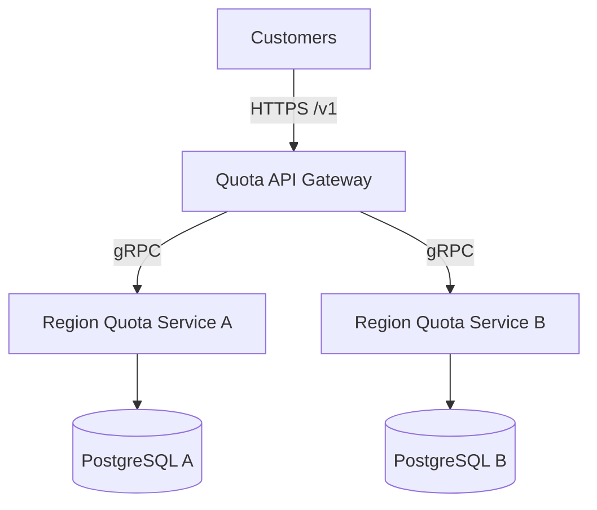
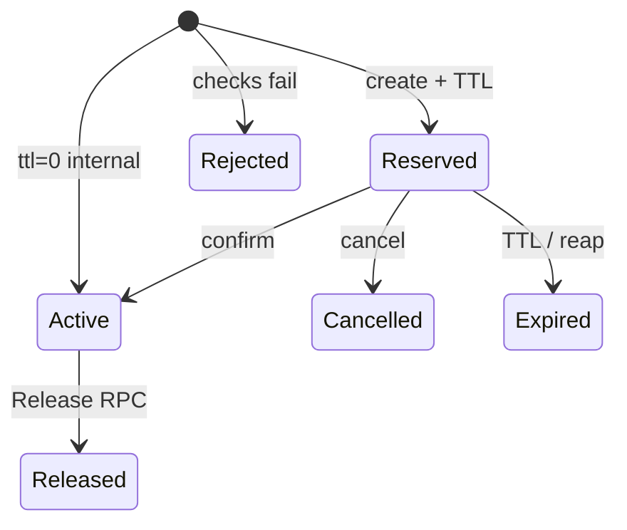

# Design

**Gateway** (public REST) → **Region Quota Service** (gRPC, one per region) → **PostgreSQL** (one DB per region). Gateway is stateless; region service owns all rules and data.

Docs: [assumptions](assumptions.md) · [requirements](requirements.md) · [deployment](deployment.md) · [scaling](scaling.md) · [technologies](technologies.md)

## Architecture



| Component | Owns |
|---|---|
| Gateway | REST, auth stub, routing, fan-out, problem+json, per-region breaker |
| Region service | Quota rules, counters, services, idempotency, reap, resync |
| PostgreSQL | Ledger + denormalized counters + idempotency store |

Region service is **never public**. Gateway maps `{region}` → backend address; `REGION_ID` must match `region_meta` at startup.

## Counters

Per region, per resource type:

- **Pool:** `total`, `baseline_allocated`, `allocated`, `reserved`
- **Customer quota:** `limit`, `allocated`, `reserved`

Remaining = limit/total − allocated − reserved. Create checks **every line** against **both** pool and customer quota in one transaction. Limits may be set below current usage (existing services kept; new creates rejected).

## Data model

One DB per region (no `region_id` on rows). Core tables: `resource_types`, `products`, `pools`, `customer_quotas`, `services`, `service_resources`, `service_events`, `idempotency_keys`, `counter_resyncs`.

- **Service:** `state` ∈ reserved | active | cancelled | expired | released | rejected; `expires_at` set iff `reserved`.
- **Ledger:** `service_resources` is source of truth; counters are denormalized and rebuildable via `ResyncCounters`.
- **Idempotency:** separate table — claim in short txn before create txn so rejections persist and duplicates don't block.

Guarded update pattern: `UPDATE … SET reserved = reserved + :n WHERE … remaining >= :n` (0 rows ⇒ quota or capacity error).

## Lifecycle



| Transition | Counters |
|---|---|
| → reserved | `reserved += n` |
| → active (confirm) | `reserved -= n`, `allocated += n` |
| cancel / expire | `reserved -= n` |
| release | `allocated -= n` |

Invalid transition ⇒ `409 invalid-state`. Late confirm after expiry commits expire, returns `reservation-expired`.

## Create path

1. Validate product, items, TTL.
2. **Claim** idempotency key (own txn): `in_progress` + 15s lease.
3. **One DB txn:** customer quota `UPDATE`s (asc resource id) → insert service + lines + event → pool `UPDATE`s (asc resource id) → complete key (`completed` + response body).
4. Failure: rollback; optional **on-demand reclaim** of expired reservations in scope → **one retry**; else store `rejected` + complete key.

**Lock order:** service → customer_quotas (asc) → pools (asc) — all mutating paths use this.

**Idempotency:** same key + same hash ⇒ replay; different hash ⇒ `422`; in progress ⇒ `409` + `Retry-After`; lease expired ⇒ guarded takeover; completion fenced on lease value.

## APIs

**Public REST** (`api/openapi/v1.yaml`): `/v1/...`, problem+json, `Idempotency-Key` on `POST .../services`.

| Method | Path | Action |
|---|---|---|
| GET | `/v1/regions` | Region status |
| GET | `/v1/problems`, `/v1/problems/{slug}` | Problem type catalog |
| GET | `/v1/products`, `/v1/regions/{region}/products` | Product catalog |
| GET | `/v1/quotas`, `/v1/availability`, `/v1/services` | Fan-out (partial OK) |
| GET/POST | `/v1/regions/{region}/quota`, `.../availability`, `.../services` | Per-region |
| GET/PATCH/DELETE | `.../services/{id}` | Get, confirm (`state: active`), cancel |
| GET | `.../services/{id}/events` | History |

Fan-out: parallel calls, per-region timeout; unhealthy regions listed in `unavailable_regions`, `"partial": true`.

### REST JSON vs gRPC

| Layer | Encoding | `int64` on the wire |
|-------|-----------|---------------------|
| **Public REST** (`/v1/*`) | OpenAPI-shaped structs + `encoding/json` in `internal/gateway/restencode.go` | JSON **numbers** (`amount`: 4) |
| **Internal gRPC** | protobuf binary | `int64` varints (not JSON) |

Do **not** serialize REST responses with [`protojson`](https://pkg.go.dev/google.golang.org/protobuf/encoding/protojson). Proto3’s [JSON mapping](https://protobuf.dev/programming-guides/proto3/#json) emits `int64` as **strings** so generic JavaScript clients avoid `Number` precision loss above 2⁵³. That is correct for protobuf-over-JSON tools; it **breaks** this OpenAPI contract, which documents `type: integer` / `format: int64`.

The gateway therefore converts protobuf messages from region services into REST DTOs before `writeJSON`. **Requests** (`POST .../services`) were always parsed with `encoding/json` into Go `int64` fields; responses now match.

**Internal gRPC** (`proto/regionquota/v1/`):

- `CapacityInternal` — Reserve, Confirm, Cancel, Release, Get/List, GetAvailability, GetQuota, ListProducts
- `CapacityAdmin` — SetPoolCapacity, SetCustomerQuota, GetPool, ResyncCounters, ExpireServices

Gateway maps gRPC errors → HTTP status + problem `type`. Admin RPCs denied to gateway identity.

## Fault tolerance

| Failure | Behavior |
|---|---|
| Gateway down | LB to another instance |
| Region replica down | Retry another replica |
| DB primary down | `UNAVAILABLE`; fail closed on writes |
| Region unreachable | Breaker → `503`; fan-out partial |
| Gateway timeout after commit | Client retries same key → stored outcome |
| Reaper delayed | On-demand reclaim on contested create |

**Expiry:** prod = CronJob `reap` each minute; compose = `--dev-reaper`. **Drift:** CronJob dry-run resync; alert if drift &gt; 0.

## Observability

JSON logs (`slog`) to stdout via `internal/obslog`: HTTP middleware (gateway), gRPC unary interceptors (client + server), pgx query tracer (region DB). Business 4xx HTTP → **warn**; 5xx → **error**; successful requests → **debug**. `LOG_LEVEL=debug` to enable SQL/RPC/request detail. `customer_id` in request logs when present; not used as metric labels.

Key metrics: `capacity.reservation.requests`, `capacity.pool.utilization`, `capacity.reaper.lag`, `capacity.resync.drift`, `gateway.region.breaker.state` — see [requirements](requirements.md) for SLOs.

## Implementation

```
internal/capacity/          domain types + errors
internal/region/regionsvc/ reserve, confirm, cancel, reap, release, resync
internal/region/postgres/   pgx + migrations (goose)
internal/region/grpcserver/ regionquota.v1
internal/gateway/           REST, fan-out, client
cmd/                        quota-gateway, region-quota-service
```

See [structure.md](structure.md) for the full tree.

Go: `pgx` (no ORM), `grpc`, `spf13/cobra`, OpenTelemetry, `log/slog`. Config via flags/env in `cmd/*` only. Submission images: distroless `static-debian12:nonroot`, UID **65532** (see [deployment.md](deployment.md)). Each package uses several small files grouped by concern (handlers, store domains, lifecycle) rather than single large sources.

## Quality

| Layer | How |
|---|---|
| Unit | `regionsvc`, gateway mapping; mocks |
| Integration | `integration` tag + real Postgres |
| E2E | Compose (+ multiregion override) |
| Contracts | Spectral on OpenAPI; `buf lint` + `buf breaking` |

**Lint (today):** `make lint` runs `buf lint`, optional local tools (`golangci-lint`, Spectral, `govulncheck` — skipped if not installed). `.golangci.yml` keeps a small default linter set. CI runs `make lint` + `make test` and a separate **e2e** job with Compose.

**CI (today):** [.github/workflows/test.yml](../.github/workflows/test.yml) — unit + integration (`make test`), lint, Docker e2e. No image publish or container scan in this repo yet.

**Deferred (later):** see [future-work.md](future-work.md) for tooling, CI, `deploy/`, benchmarks, and deeper test coverage planned after the Compose submission.

## Key decisions

- **Postgres counters, not Redis** — counters and ledger in one transaction; no cross-store races.
- **Per-region limits only** — no cross-region coupling on create.
- **Unified `services` table** — confirm is update-in-place, not copy-between-tables.
- **Fail closed** when region cannot durably write.
- **Availability GET** is advisory; **POST create** is the guarantee.

Production Kubernetes/CNPG/Vault/mTLS: reference only — [deployment.md](deployment.md).